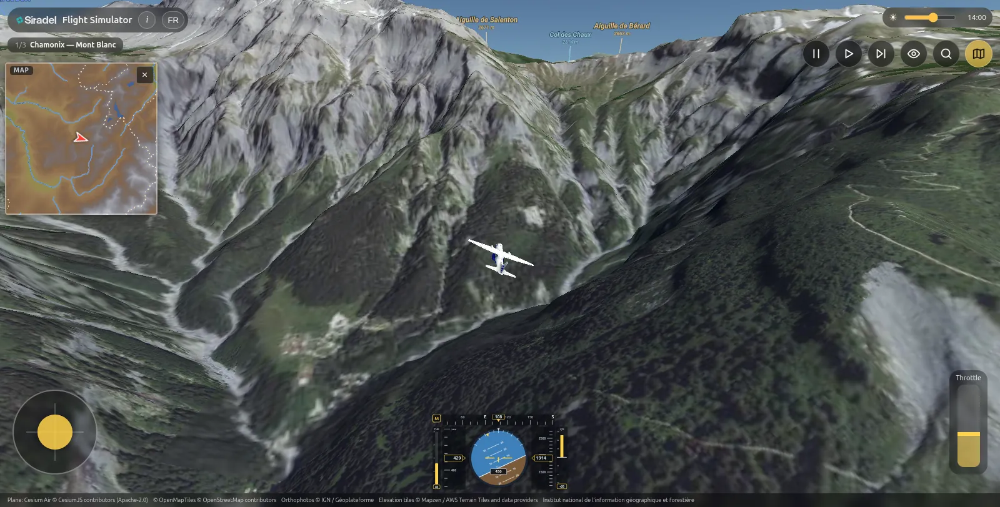

# Flight Simulator — plane, drone and shuttle over France, built with Horizon

A small **browser flight simulator** in English and French, on phones as well as
desktops: a tour of France in three scenes, each with its own vehicle. A plane
over the Chamonix valley, a drone over the city of Rennes, and the Space Shuttle
in low orbit over the Mediterranean, on IGN aerial imagery (with real relief
in the Alps).

[](https://oss.siradel.com/horizon-demo-flight-simulator/)

**[▶ Live demo](https://oss.siradel.com/horizon-demo-flight-simulator/)**

## Features

- A tour of three scenes, each playing a recorded flight; take the controls at
  any time, or skip to the next scene:
  - **Chamonix — Mont Blanc**, by plane: IGN RGE ALTI relief and orthophotos,
    names of towns, peaks, passes and lakes
  - **Rennes**, by drone: buildings extruded and coloured by type, and
    street names
  - **Low Earth orbit**, by Space Shuttle: the Mediterranean from 400 km, with the
    atmosphere at the limb and the sun pinned in space
- Three flight models: an arcade aeroplane (thrust, drag, lift and stall, assist
  or manual control), and a hovering one for the drone and the shuttle
- Primary flight display for the plane (attitude, speed and altitude tapes,
  heading, vertical speed, throttle, radio altimeter and ground proximity
  warning), a readout strip for the drone and the shuttle
- Chase and cockpit cameras, look around with the mouse or a finger
- Place search (IGN geocoding): set a course with heading bug, distance and ETA,
  or teleport there
- Minimap (a second Horizon scene view), time-of-day slider for the sun
- On-screen stick, throttle (or climb) lever and action buttons, on every
  device (mouse or finger); pinch to zoom on touch screens

## Controls

On screen: the stick on the left, the throttle (or climb) lever on the right,
and buttons to pause, resume the demo, skip to the next scene, change view,
search a place and show the minimap. Every action also has a keyboard shortcut,
listed in the in-app **About** dialog.

## Built with Horizon

Flight Simulator is a demo of
[Horizon](https://github.com/siradel-oss/horizon), Siradel's open source real-time
3D engine for map data on a globe (WebAssembly, WebGL 2, TypeScript). It shows
terrain and imagery streaming from public tile servers, vector tile labels,
extruded buildings styled by attribute, animated glTF models driven every frame,
two scene views at once, the globe and its atmosphere seen from orbit, and
dynamic sun lighting, without any UI framework. The flight models, instruments
and camera run in the page.

- Horizon: [website and documentation](https://horizon.oss.siradel.com) ·
  [getting started](https://horizon.oss.siradel.com/doc/getting_started.html) ·
  npm packages `@siradel-oss/horizon-{api,core,protocol}`
- More Horizon demos: [demo gallery](https://sce.oss.siradel.com/demos/)

> **A demonstrator.** Horizon grew out of the [SCE](https://sce.oss.siradel.com)
> ecosystem. The flight models are deliberately simple and are not real ones: no
> takeoff or landing, no weather, no navigation data, and a shuttle far faster
> than any orbit. **Do not use it to learn or prepare a flight.**

## En français

Flight Simulator est un petit **simulateur de vol dans le navigateur**, sur
ordinateur comme sur téléphone : un tour de France en trois scènes. En avion
au-dessus de la vallée de Chamonix, en drone au-dessus de Rennes (bâtiments
colorés par type et noms de rues), en navette spatiale en orbite basse
au-dessus de la Méditerranée, sur le relief et les orthophotos de l'IGN. Manche
et boutons à l'écran, ou clavier (touches listées dans la fenêtre « À propos »),
recherche de lieu avec cap à suivre ou téléportation.
Démonstrateur du moteur 3D open source Horizon, interface en français et en
anglais. Les modèles de vol sont volontairement simplifiés.

## Run it

Requirements: Node.js ≥ 22.12, pnpm ≥ 10, and a browser with WebGL 2 and
`SharedArrayBuffer`.

```bash
pnpm install
pnpm dev        # http://localhost:5173
```

| Command        | Description               |
| -------------- | ------------------------- |
| `pnpm dev`     | Development server        |
| `pnpm build`   | Static build into `dist/` |
| `pnpm preview` | Serves the build locally  |

The build uses relative URLs (Vite base `./`), so `dist/` can be served under
any subpath. `?lang=en|fr` sets the interface language, and `?scene=` the
scene the tour opens on (`chamonix`, `rennes`, `planet`, or an index).

### Serving requirements

Horizon runs its WASM core across threads, which requires `SharedArrayBuffer`.
The static server must therefore send these headers on every response:

```
Cross-Origin-Opener-Policy: same-origin
Cross-Origin-Embedder-Policy: require-corp
```

Every tile server used here answers with CORS headers, so `require-corp` is
fine. The server must also serve `hrz_core.wasm` as `application/wasm`. The dev
and preview servers already do all of this (see `vite.config.ts`).

Hosts that cannot set headers, such as GitHub Pages, rely on the bundled
[coi-serviceworker](https://github.com/gzuidhof/coi-serviceworker) (MIT), which adds
them client-side. The `.github/workflows/deploy.yml` workflow builds and publishes
the app to GitHub Pages on every push to `main`.

## Stack

- [Horizon](https://horizon.oss.siradel.com): `@siradel-oss/horizon-{api,core,protocol}`
- TypeScript and the DOM, no framework; Vite 7

```
src/
├── main.ts              # Boot, frame loop, scene tour, instruments, camera, search, minimap
├── scenes.ts            # The three scenes: place, vehicle, layers, recorded path
├── vehicles.ts          # Plane, drone and orbiter: model, flight model, camera, HUD
├── config.ts            # All tunables: start, flight model, camera, imagery, labels, Rennes
├── plane.ts             # The flight models (aircraft and hover)
├── sun.ts               # Sun position for the scene pinned in space
├── input.ts             # Keyboard and touch input state
├── horizon.ts           # Horizon: init, layers, vehicle models, cameras, scene views
├── trajectory*.ts       # Recorded scene paths and their player / recorder
├── geocode.ts           # IGN place search
├── i18n.ts              # EN/FR strings
└── ui/                  # About dialog, touch stick and lever
public/models/           # Plane, drone and Space Shuttle models
public/data/rennes/      # Rennes buildings (Geobuf tiles)
public/fonts/            # Roboto, for the map labels
```

To record a new path for a scene, open it (`?scene=…`), press T, fly the leg,
press T again and paste the JSON shown into `src/trajectory-data.ts`.

## Data

Map data is streamed at runtime from public servers, except an extract of
central Rennes (about 6 × 5 km), which ships in `public/data/rennes/`.

| Producer                    | Datasets                                                                                                                          | Licence                                                                         |
| --------------------------- | --------------------------------------------------------------------------------------------------------------------------------- | ------------------------------------------------------------------------------- |
| IGN, Géoplateforme          | Orthophotos (France, and world imagery seen from orbit), RGE ALTI relief (Chamonix), place search (geocoding)                     | [Licence Ouverte 2.0](https://www.etalab.gouv.fr/licence-ouverte-open-licence/) |
| Mapzen, AWS                 | Terrain Tiles (Terrarium) worldwide elevation, under the Chamonix relief outside France                                          | [Attribution](https://github.com/tilezen/joerd/blob/master/docs/attribution.md) |
| OpenMapTiles, OpenStreetMap | Places, peaks, passes, lakes and the minimap layers, © OpenMapTiles © OpenStreetMap contributors (tiles served by data.gouv.fr) | [ODbL 1.0](https://www.openstreetmap.org/copyright)                             |
| Siradel                     | Rennes buildings (LOD1), `public/data/rennes/buildings`                                                                           | © Siradel, see below                                                            |

The same information is available in the in-app **About** dialog.

## License

Code: [MIT](LICENSE). Data keeps the licence of its producer (see above). The
Rennes buildings in `public/data/rennes/` are © Siradel and are not
covered by the MIT licence: they are provided to run this demo; for any other
use, contact [opensource@siradel.com](mailto:opensource@siradel.com).

Models, in `public/models/`:

- `plane.glb`: Cesium Air from the [CesiumJS](https://github.com/CesiumGS/cesium)
  sample data, © CesiumJS contributors, under the Apache License 2.0, repainted
  with the Horizon logo.
- `drone-anim.glb`: the drone (`drone_nologo.glb`) from
  [amvlab/aircraft-models](https://github.com/amvlab/aircraft-models),
  © 2026 amvlab, under [CC BY 4.0](https://creativecommons.org/licenses/by/4.0/).
  Modified: rotors split out and a spin animation added.
- `shuttle.glb`: [Space Shuttle (D)](https://science.nasa.gov/3d-resources/space-shuttle-d/),
  NASA/Johnson Space Center, from NASA 3D Resources, used under the
  [NASA media usage guidelines](https://www.nasa.gov/nasa-brand-center/images-and-media/).
  Modified: the payload bay doors, shipped as separate files in the same
  resource, added closed (untextured: their texture is not published); the NASA
  insignia, the US flags and the "United States" lettering painted out of the
  textures. NASA does not endorse this demo.

The Roboto font (`public/fonts/`) is © Google, under the Apache License 2.0.
The Apache licence text is in `public/licenses/Apache-2.0.txt`.

## Contact

Siradel open source: [opensource@siradel.com](mailto:opensource@siradel.com) ·
[www.siradel.com](https://www.siradel.com)
